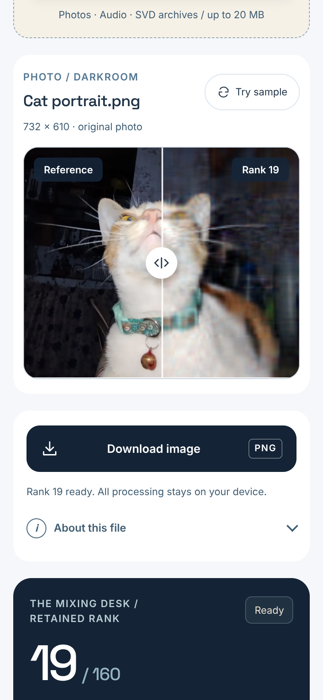
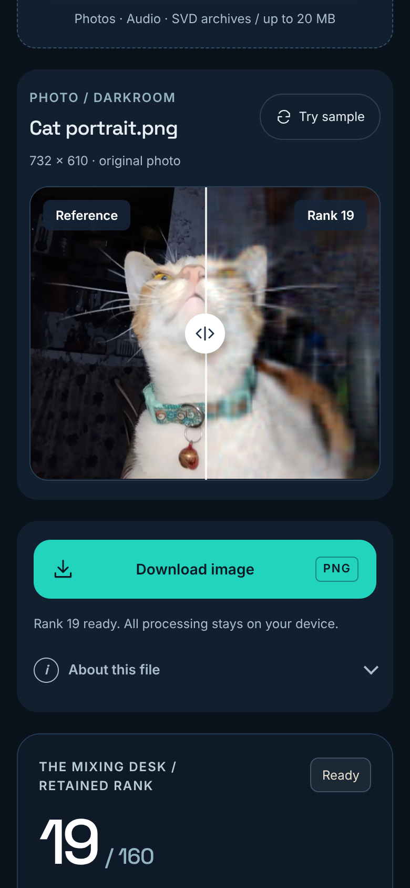
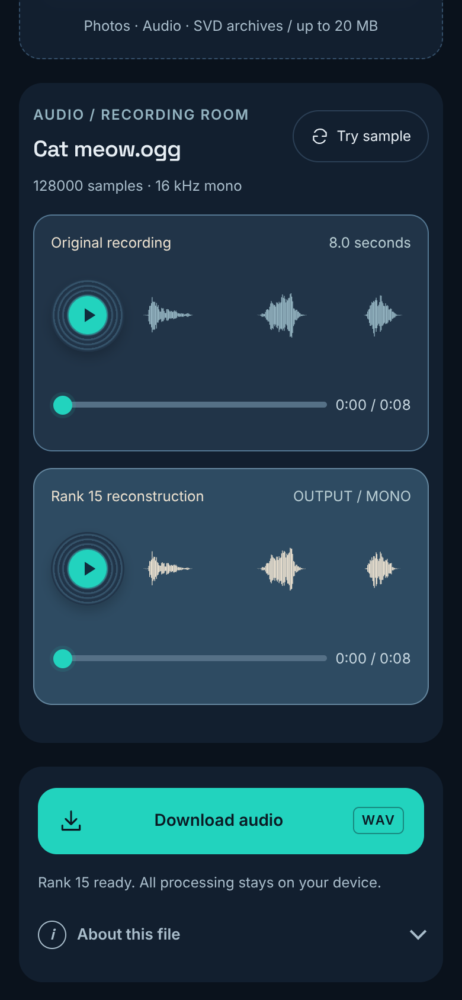
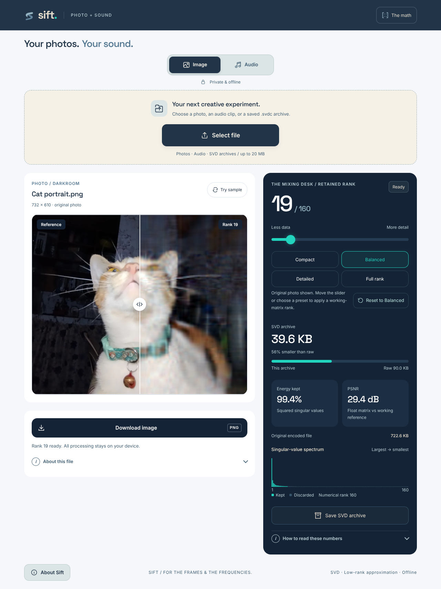

# Sift

An offline Android studio for exploring SVD and low-rank approximation on photos and sound. Pick a file, move the rank slider, and compare what changes. Nothing leaves the device: the app asks for no Internet or storage permissions.

| Phone, light | Phone, dark | Audio |
| --- | --- | --- |
|  |  |  |

Screenshots are the web interface rendered in a browser at phone and desktop sizes.

## What it does

- Import an image, an audio clip or a saved `.svdc` archive (up to 20 MB).
- Adjust the retained rank and compare the reconstruction, energy kept, error and the real size of the factor archive.
- Export `.svdc` factors, or the reconstruction as PNG / WAV. Share the PNG / WAV from the Android share sheet.
- Photos: compare on a draggable split. Rank changes use a working copy up to 192px on the longest edge, composited on white.
- Audio: first 8 seconds, resampled to 16 kHz mono, arranged in 128-sample rows.

Savings compare factor bytes with raw working pixels or PCM, not with your original JPEG or MP3, which may already be smaller. Energy is a matrix measure, not perceived quality. Full-rank quantized archives are not bit-exact originals. Sift is educational, not a replacement for standard codecs.

## Run it

The Android Studio project root is this repository (the installed app is Sift, `dev.sift.rank`). The folder may still be called `compressor` on the author's machine.

- Windows: `scripts/build.ps1` runs the math tests, bundles the web assets, builds the debug APK and runs lint. Add `-Test` with one running emulator to run `StudioTest`. Java 17 and the Android SDK are expected under `%LOCALAPPDATA%` (see `scripts/setup-android.ps1`).
- Any OS: `npm install`, `npm test` for the math tests, then `./gradlew assembleDebug` (or open the folder in Android Studio).
- The interface in `web/` also opens in a normal browser through any static server, for quick design checks.

## Versions

Release notes live in `docs/` (latest: [release-1.5.0.md](docs/release-1.5.0.md)). Design notes: `docs/design.md`. The version shown in About Sift matches `app/build.gradle`.

## Credits

Space Grotesk, ml-matrix. The meow sample is by Heismark (Wikimedia Commons, public domain); see `web/samples/CREDITS.md`.
